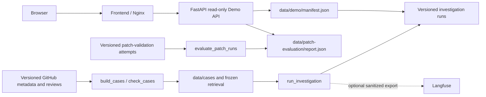
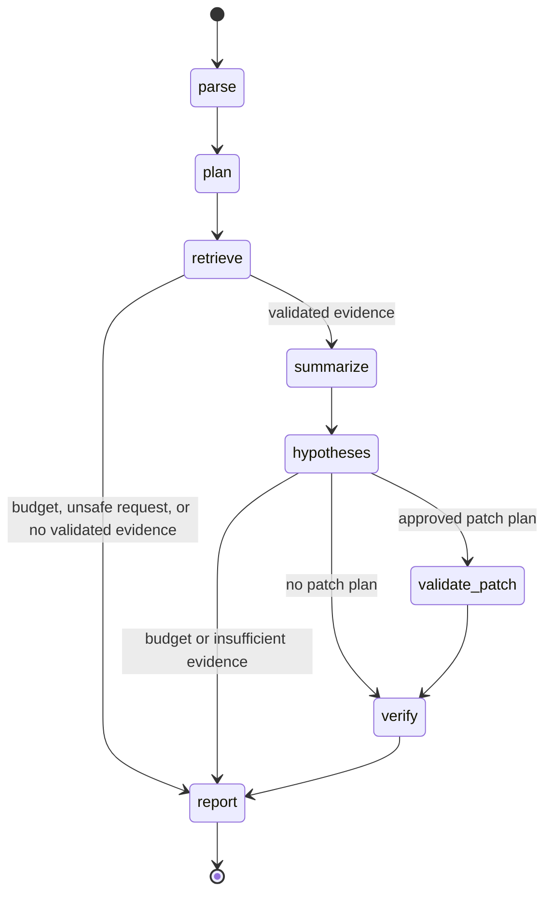

# Reproducible release and safety model

## System architecture

Docker Compose also starts PostgreSQL and waits for it to be healthy. The public
Demo API reads the versioned files above; PostgreSQL and Langfuse are not needed
to reproduce its five recorded trajectories or the evaluation metrics. The
offline replay builder regenerates the two safety trajectories. The other
three trajectories are recorded investigation runs, not fresh model calls.

## Investigation state machine

`report` emits exactly one of `supported`, `insufficient_evidence`,
`budget_exhausted`, and `unsafe_request`, with a stop reason and unresolved
questions. The gateway validates snapshot references and enforces tool, time,
hypothesis, and patch budgets before an investigation tool can run.

## One end-to-end trace

The recorded `starlette-issue-1552` run in
`data/investigations/starlette-issue-1552/run.json` is the supported Demo case.
It fixes Starlette commit `e086fc2da361767b532cf690e5203619bbae98aa`.
Its ten ordered events parse and plan the issue, run `search_code` and
`semantic_search`, summarize validated evidence, record one model response,
form a hypothesis, verify it, and report `supported` with stop reason
`verified_root_cause`. The report cites `starlette/schemas.py` lines 66–72 at
that commit and keeps four unresolved questions. The citation is evidence for
the reported hypothesis, not a claim that every detail of the upstream bug was
proved. The browser reads this committed run through
`/api/demo/cases/starlette-issue-1552`; it does not invoke the model.

## Threat model

| Risk | Boundary and current control | Remaining limit |
| --- | --- | --- |
| Prompt injection in issues or retrieved code | Issue and candidate text is treated as untrusted; the report prompt instructs the model to ignore embedded instructions, while `ToolGateway` validates outputs and allows only named operations. | A model can still misread evidence; review citations and unresolved questions. |
| Command execution and patch abuse | The public Demo API accepts only read-only requests for five fixed IDs. Patch validation requires approved test and patch IDs and runs in a resource-limited container with no network. | Local patch validation trusts the Docker daemon and the approved test manifest. |
| Network access | Offline reproduction uses committed metadata and fixed responses. Patch containers use `--network none`; the Demo performs no GitHub API calls. | First-time dependency and image installation may contact package registries. |
| Secret exposure | Reproduction and CI require no model or Langfuse key. Optional Langfuse export sends allowlisted summaries; `.env` is ignored by Git. | Live model or observability runs require the operator to protect their own keys. |
| Path traversal and future evidence | File reads resolve beneath the fixed snapshot; candidates must match its commit and lines. Case validation rejects post-cutoff investigation evidence. The Demo maps only manifest IDs to fixed paths. | A malicious local checkout or tampered versioned files are outside this boundary. |
| Resource exhaustion | Investigation budgets cap calls, runtime, hypotheses, and patch attempts. The Demo rate limits requests and caps concurrent responses and streams; patch containers cap CPU, memory, processes, output, and time. | These local limits do not replace an external gateway for Internet exposure. |
